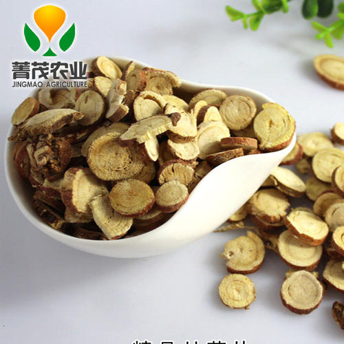
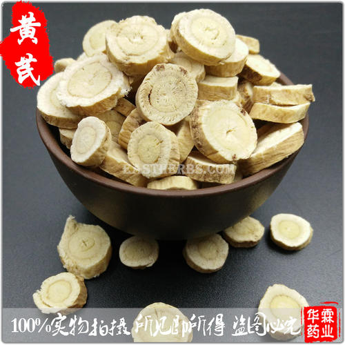
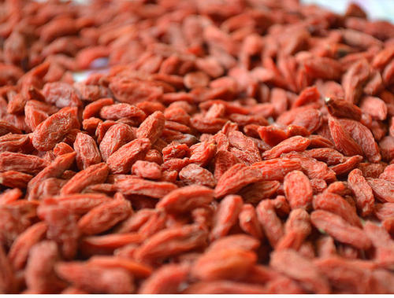

<div align="center">

# 中草药图像数据集

**72 个类别 · 7,176 张图片 · 按类别整理的 JPG 图像**

[对应识别项目](https://github.com/kayaduster607-jpg/chinese-herbal-recognition) · [目录结构](#目录结构) · [使用说明](#使用说明)

</div>

本仓库存放中草药图像分类项目的数据。每个子目录对应一个类别，目录名使用拼音；图像保持原始文件名，便于追溯。数据用于图像分类研究与模型训练。

| 数据概况 | 数值 |
| --- | ---: |
| 类别 | 72 |
| 可发布图片 | 7,176 张 JPG |
| 图片总大小 | 约 1.05 GB（约 0.98 GiB） |
| 公开前处理 | 原目录中两张无法解码的白芍图片已排除 |

## 数据预览

| 甘草 Gancao | 黄芪 Huangqi | 枸杞子 Gouqizi |
| --- | --- | --- |
|  |  |  |

以上图片是数据集中的真实样本，类别以文件夹标签为准。图像模型的预测需要独立核验，不用于药材鉴定或用药决策。

## 目录结构

```text
images/
├── Anxixiang/
├── Baibiandou/
├── Baishao/
├── Gancao/
├── Gouqizi/
├── Huangqi/
└── ... 其余类别
```

所有图片以文件夹名称作为分类标签；本仓库保存原始类别目录，未指定固定训练、验证和测试划分。

## 使用说明

```bash
git clone https://github.com/kayaduster607-jpg/chinese-herbal-dataset.git
```

下载较大，请预留足够磁盘空间。训练脚本可使用 `images/` 作为输入，按类别生成 70% / 15% / 15% 划分；请将随机种子、划分结果和模型一起记录，以便复核。

项目曾使用单独保存的 7,176 张训练数据。`D:\dataset` 原有 7,178 张，本次检测并排除了其中两张无法完整解码的图片；原始磁盘内容未修改。

## 来源与使用

图片由项目提供者说明为其拍摄或制作，并同意在此公开。仓库未指定可再分发的开源数据许可；如需复用或再分发，请先联系仓库所有者确认使用条件。

<div align="center">

[查看模型代码与训练记录 →](https://github.com/kayaduster607-jpg/chinese-herbal-recognition)

</div>
